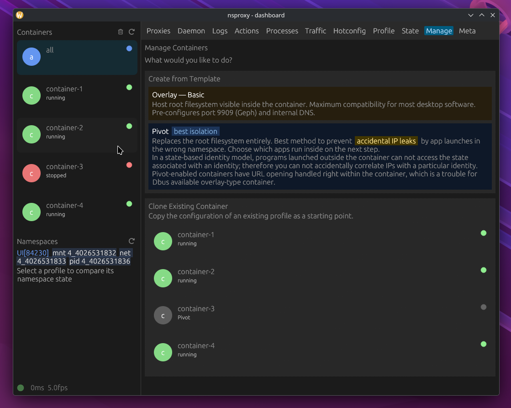
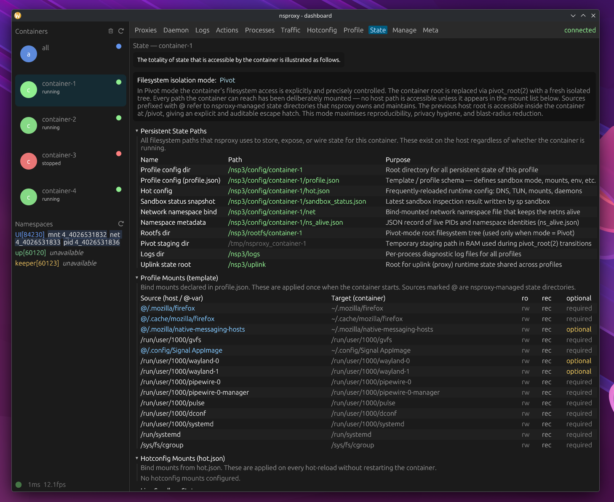
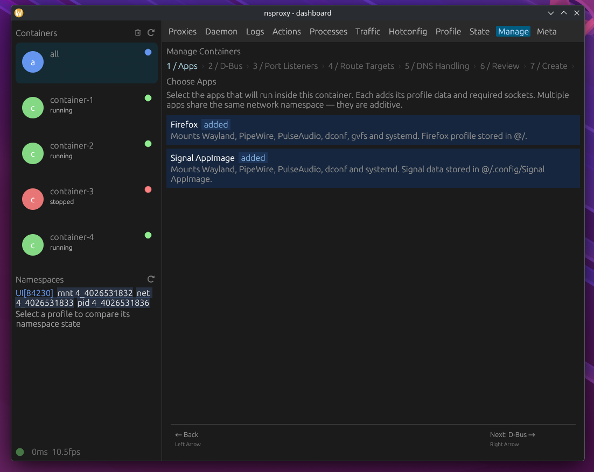
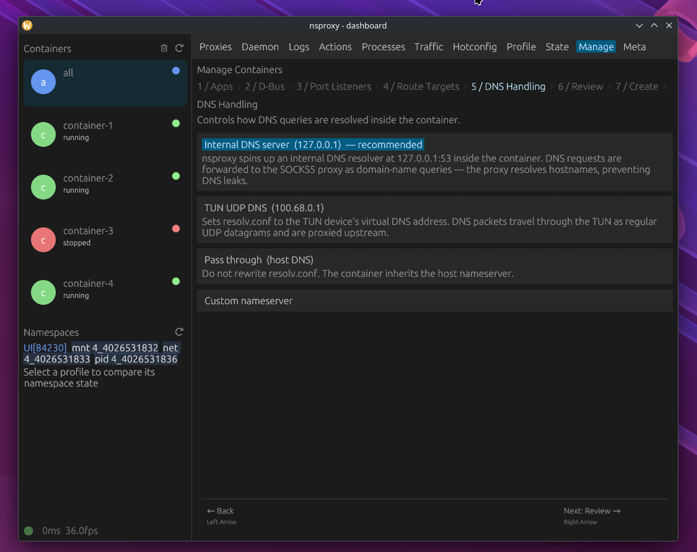
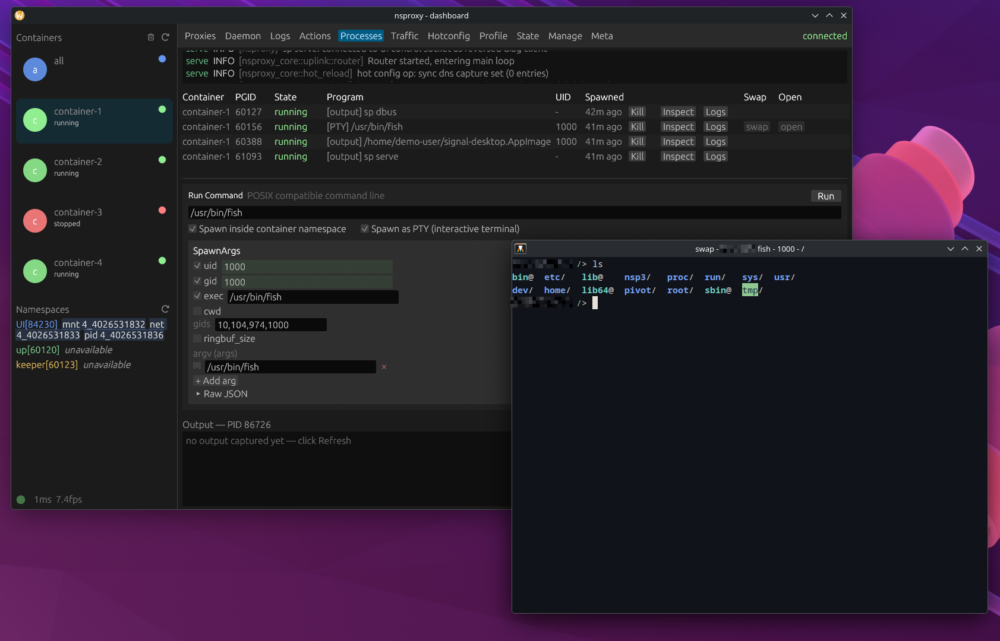

# Network-native containerization system

> nsproxy, network-namespace with SOCKS5 proxy







- You can run dockerd within a container, with everything proxied by a SOCK5 proxy
- The sandbox may defend against _casual_ attackers, or otherwise unnecessary state-cross-contamination of softwares
- The codebase is a singleton in full Rust. You are expected to modify the code. 
- Native [alacritty](https://github.com/alacritty/alacritty) integration at full speed
- It's shipped with a GUI written with EGUI, meant to daily-drive desktop with paranoia-level of network control
- You can control the degree of isolation. In the least isolated case, only network namespace is unshared, such that no softwares break.
- status, branch `main` is always production-ready

## Building

Build both application binaries (including the serve console by default):

```sh
./build-ui.sh
```

nsproxy and the network daemon are separate processes. Build nsproxy normally:

```sh
./build-ui.sh
```

Initialize and run the standalone daemon when you want it available:

```sh
nix run .#lokinet-socks6d -- init --bootstrap-file ./bootstrap.signed
nix run .#lokinet-socks6d
```

`init` creates writable config/data paths and optionally imports Lokinet's
signed bootstrap router-contact file. The daemon defaults to XDG user paths;
`--socket`, `--config`, and `--data-dir` override them. The data directory must
be private because it holds key material. nsproxy never starts the daemon;
configure the same SOCKS6 endpoint in a profile's network settings and select
SOCKS6 as the default route or for specific host rules. The general SOCKS6 route
supports domain and IP-addressed destinations. In pivot profiles, start the
daemon before sandboxing so its Unix socket directory can be bound into the
profile. TCP endpoints are unencrypted and should be limited to trusted networks.

Exercise proxy endpoints with the separate protocol-adaptable test lab:

```sh
nix run .#socks6-lab -- proxy
nix run .#socks6-lab -- responder
nix run .#socks6-lab -- client --proxy tcp://127.0.0.1:1086 --responder 127.0.0.1:19090
nix run .#socks6-lab -- probe --proxy unix:///path/to/proxy.socks6
nix run .#socks6-lab -- bench --proxy unix:///path/to/proxy.socks6 --responder 127.0.0.1:19090
nix run .#socks6-lab -- suite --proxy unix:///path/to/proxy.socks6 --tcp-responder 127.0.0.1:19090 --udp-responder 127.0.0.1:19090
nix run .#socks6-lab -- lokinet tcp --proxy unix:///run/lokinet-socks6/lokinet.socks6 --target peer.loki:443
nix run .#socks6-lab -- lokinet http --proxy unix:///run/lokinet-socks6/lokinet.socks6 --url https://service.loki/
```

See [SOCKS6 Lab](./external/socks6-lab/README.md) for echo listeners,
stream benchmarks, parallelism sweeps, and feature-suite options.
